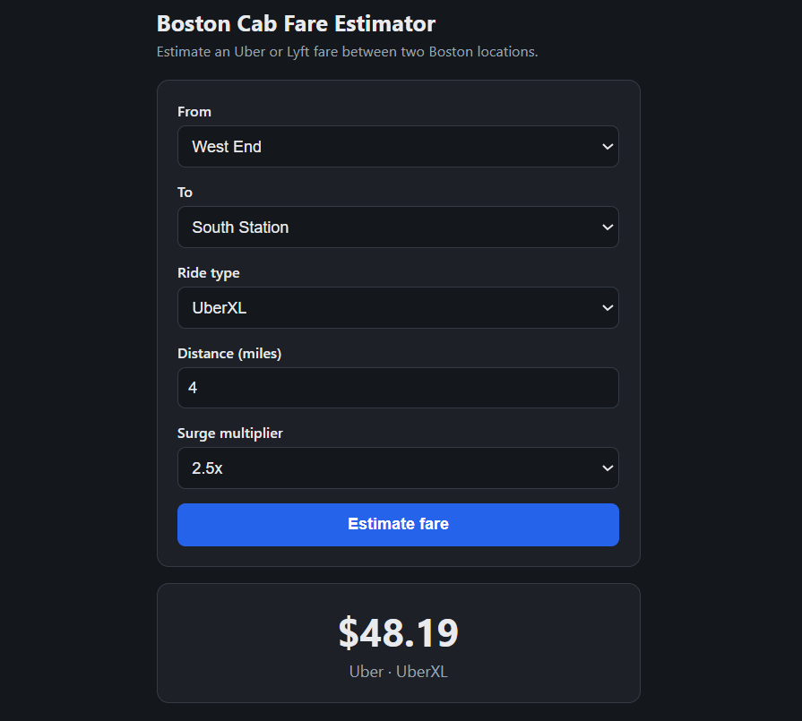

# Boston Cab Fare Estimator

Estimate an Uber or Lyft fare between two Boston locations. A machine learning model (XGBoost) is served through a FastAPI backend with a simple web form, and the whole app is packaged with Docker and deployed on Render.

**Live demo:** https://cab-fare-estimator-app.onrender.com/

> The demo runs on Render's free plan. If nobody has opened it for a while, the first page load can take about a minute while the service wakes up.



---

## Table of contents

- [What it does](#what-it-does)
- [Tech stack](#tech-stack)
- [Dataset](#dataset)
- [Model](#model)
- [API](#api)
- [Project structure](#project-structure)
- [Run it locally](#run-it-locally)
- [Run with Docker](#run-with-docker)
- [Retrain the model](#retrain-the-model)
- [Deployment](#deployment)
- [Limitations](#limitations)
- [Acknowledgements](#acknowledgements)

---

## What it does

You choose:

- a pick-up location and a drop-off location in Boston
- a ride type (for example UberX, UberXL, Lyft)
- the trip distance in miles
- a surge multiplier

The app returns an estimated price in US dollars, together with the cab company (Uber or Lyft) and the ride type.

Example: West End to South Station, UberXL, 4 miles, 2.5x surge returned **$48.19** in the live app.

The API also checks the input before it reaches the model. It returns a clear error (HTTP 422) for a location or ride type the model has never seen, a distance outside the range seen during training, or the same pick-up and drop-off location.

## Tech stack

| Part | Tool |
|---|---|
| Language | Python 3.11 |
| Model | XGBoost |
| Data handling and metrics | pandas, scikit-learn |
| Model saving and loading | joblib |
| Web API | FastAPI, served with Uvicorn |
| Web page | HTML form (`app/static/index.html`) |
| Packaging | Docker |
| Hosting | Render (Docker web service, free plan) |
| Source control | Git and GitHub |

## Dataset

The model is trained on the Kaggle dataset **Uber & Lyft Cab prices**:

https://www.kaggle.com/datasets/ravi72munde/uber-lyft-cab-prices

The dataset has two files, which are used in this project:

- `cab_rides.csv`: ride price estimates for Uber and Lyft, with pick-up, drop-off, ride type, distance and surge multiplier
- `weather.csv`: weather readings for the same Boston locations

According to the dataset description, the data was collected by querying the Uber and Lyft APIs at a few busy Boston locations, roughly over a week in November 2018. The prices are real price estimates for simulated rides: they show what a ride would have cost, not rides that actually took place.

The CSV files are not stored in this repository (they are listed in `.gitignore`). To retrain the model, download them from Kaggle and place them in a `data/` folder. See [Retrain the model](#retrain-the-model). Please check the dataset page for its license and terms of use.

## Model

- **Task:** predict the ride price (regression).
- **Algorithm:** XGBoost regressor.
- **Inputs:** pick-up location, drop-off location, ride type, distance (miles) and surge multiplier. Weather is not an input to the app.
- **Preparation:** the categorical inputs (locations and ride type) are one-hot encoded. The app builds each request as one row with the same columns, in the same order, as in training. The list of columns is saved in `model/columns.json`.
- **Evaluation:** the model was evaluated on a held-out test split.

### Results

<!-- Replace TBD with the real numbers. They are shown at /health on the live app (model_metrics). -->

| Metric | Value |
|---|---|
| MAE (USD) | TBD |
| RMSE (USD) | TBD |
| R² | TBD |

The saved model is `model/model.joblib`. The same numbers are returned by the `/health` endpoint.

## API

Interactive documentation (Swagger UI) is available at `/docs` once the app is running.

| Method | Endpoint | Purpose |
|---|---|---|
| GET | `/` | Web form |
| GET | `/health` | Health check, also returns the model metrics |
| GET | `/options` | Allowed locations, ride types, distance range and surge values (used to fill the form) |
| POST | `/predict` | Returns the estimated fare |

### Example request

```bash
curl -X POST https://cab-fare-estimator-app.onrender.com/predict \
  -H "Content-Type: application/json" \
  -d '{
        "source": "West End",
        "destination": "South Station",
        "ride_type": "UberXL",
        "distance": 4.0,
        "surge_multiplier": 2.5
      }'
```

### Example response

```json
{
  "predicted_price_usd": 48.19,
  "cab_type": "Uber",
  "ride_type": "UberXL"
}
```

### Input rules

| Field | Rule |
|---|---|
| `source`, `destination` | Must be a location from `/options`, and must be different from each other |
| `ride_type` | Must be a ride type from `/options` |
| `distance` | Greater than 0, and inside the distance range returned by `/options` |
| `surge_multiplier` | Must be one of the values returned by `/options` (default `1.0`, meaning no surge) |

## Project structure

```
cab-fare-estimator-app/
├── app/
│   ├── main.py            # FastAPI app: loads the model and serves predictions
│   └── static/
│       └── index.html     # Web form
├── model/
│   ├── model.joblib       # Trained XGBoost model
│   └── columns.json       # Feature columns, allowed values and model metrics
├── src/
│   └── train_model.py     # Training script that creates the files in model/
├── Dockerfile
├── .dockerignore
├── .gitignore
└── requirements.txt       # Pinned library versions
```

## Run it locally

You need Python 3.11 and Git.

```bash
git clone https://github.com/Kaniz-Reza/cab-fare-estimator-app.git
cd cab-fare-estimator-app

# create and activate a virtual environment
python -m venv .venv
# Windows (PowerShell):  .venv\Scripts\Activate.ps1
# Windows (Git Bash):    source .venv/Scripts/activate
# Mac / Linux:           source .venv/bin/activate

pip install -r requirements.txt

uvicorn app.main:app --reload --port 8000
```

Then open http://127.0.0.1:8000 for the form, or http://127.0.0.1:8000/docs for the API documentation.

## Run with Docker

```bash
docker build -t cab-fare-estimator-app .
docker run -p 8000:8000 cab-fare-estimator-app
```

Then open http://localhost:8000.

A few notes about the `Dockerfile`:

- It uses `python:3.11-slim` and installs `libgomp1`, which XGBoost needs on Linux.
- During the build it swaps `xgboost` for `xgboost-cpu` (same code, without the large GPU libraries), which keeps the image smaller.
- It copies only what the running app needs: the `app/` and `model/` folders.
- The server listens on the `PORT` given by the hosting service, or on port 8000 when it is not set.

## Retrain the model

1. Download the dataset from Kaggle (see [Dataset](#dataset)).
2. Put `cab_rides.csv` and `weather.csv` in a `data/` folder in the project root.
3. Run the training script from the project root:

   ```bash
   python src/train_model.py
   ```

The script trains the model and writes the files in `model/`, which the API loads when it starts.

Use the same library versions as in `requirements.txt`. A model saved with one version of XGBoost or scikit-learn may not load correctly with another.

## Deployment

The app is deployed on [Render](https://render.com) as a Docker web service:

- Render builds the image from the `Dockerfile` in this repository (branch `main`).
- The health check path is `/health`.
- Pushing a new commit to `main` can trigger a new deploy.

## Limitations

- The model was trained on data from Boston from a short period in late 2018. Real fares today can be different.
- The data is made of price estimates for simulated rides, not completed trips.
- Only the locations, ride types, distances and surge values that appear in the training data are accepted.
- The result is an estimate. It is not a quote from Uber or Lyft.
- Time of day and weather are not inputs to the app.

## Acknowledgements

- Dataset: **Uber & Lyft Cab prices** on Kaggle, by `ravi72munde`: https://www.kaggle.com/datasets/ravi72munde/uber-lyft-cab-prices